  <h1>HỒ MINH NGHĨA</h1>
  
<strong>Mobile &amp; Fullstack Web Developer</strong> 🌼

  <!-- Typing SVG Animation -->
  

    

  <!-- Terminal Component (3 Auto-rotating Slides: Whoami · Projects · Tech Stack) -->
  

    

  <!-- Minimalist Badges -->
  
  &nbsp;
  
  &nbsp;
  

 

---

### 🚀 Featured Work & Projects

- **ArenaS Platform** `React Native` `Expo` `React.js` `Node.js` `Express` `MySQL`  
  Comprehensive sports arena booking & tournament management ecosystem built as a unified Monorepo, featuring a native mobile app for athletes and a real-time web portal for arena operators.  
  👉 [Repository: Nghiamh/ArenaS-Platform](https://github.com/Nghiamh/ArenaS-Platform)

- **Emergency Response Dispatch System** `React 19` `TypeScript` `SignalR` `Mapbox GL` `TailwindCSS`  
  Real-time emergency dispatch management platform with live ambulance tracking, heatmap visualization, instant dispatch coordination, and WebSocket communication.  
  👉 [Repository: emergency-dispatch-frontend](https://github.com/emergency-dispatch/emergency-dispatch-frontend)

---

  <em><strong>🌼 "Tập trung tạo dựng sản phẩm mượt mà, tối ưu và bền vững."</strong></em>

