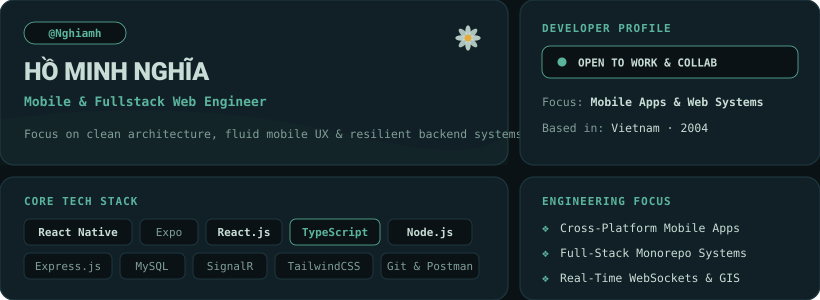

  <!-- Bento Grid Dashboard Component (No Avatar Required) -->
  

    

  <!-- Minimalist Badges with Soft Palette -->
  
  &nbsp;
  
  &nbsp;
  

 

---

### 🚀 Featured Engineering Projects

| Project | Description | Tech Stack | Repository |
| :--- | :--- | :--- | :--- |
| **ArenaS Platform** | Sports Arena Booking System (Backend, Web & Mobile Monorepo) | React Native, React.js, Node.js, Express, MySQL | [🔗 ArenaS-Platform](https://github.com/Nghiamh/ArenaS-Platform) |
| **Emergency Dispatch** | Real-time Emergency Response & Fleet Dispatch Management | React 19, TypeScript, SignalR, Mapbox GL, TailwindCSS | [🔗 emergency-dispatch-frontend](https://github.com/emergency-dispatch/emergency-dispatch-frontend) |

---

### 🛠️ Comprehensive Tech Stack

  

| Category | Technologies & Tools |
| :--- | :--- |
| **Languages** | `JavaScript (ES6+)`, `TypeScript`, `HTML5`, `CSS3`, `SQL` |
| **Mobile Development** | `React Native`, `Expo`, `React Navigation`, `Redux Toolkit`, `NativeWind` |
| **Frontend Web** | `React.js 19`, `TailwindCSS`, `Vite`, `Axios`, `React Router` |
| **Backend & Realtime** | `Node.js`, `Express.js`, `RESTful APIs`, `SignalR (WebSockets)` |
| **Databases** | `MySQL`, `MongoDB` |
| **Tools & Platforms** | `Git`, `GitHub`, `Postman`, `VS Code` |

---

  <em><strong>🌼 "Clean code, fluid UX, and resilient architecture."</strong></em>

