  

  
  

---

### 📌 About Me

- 🎓 **Education:** Computer Science student.
- 💡 **Focus:** Mobile Development (React Native) & Fullstack Web (React, Node.js).
- 🎯 **Goal:** Seeking Internship / Fresher Developer opportunities.
- 📬 **Contact:** [hako1412004@gmail.com](mailto:hako1412004@gmail.com)

---

### 🚀 Featured Projects

| Project | Description | Tech Stack | Repository |
| :--- | :--- | :--- | :--- |
| **ArenaS** | Sports Arena Booking System (Backend, Web & Mobile) | React Native, React.js, Node.js, Express, MySQL | [ArenaS-Platform](https://github.com/Nghiamh/ArenaS-Platform) |
| **Emergency Dispatch** | Real-time Emergency Response & Dispatch Management | React, TypeScript, SignalR, Mapbox GL, TailwindCSS | [emergency-dispatch-frontend](https://github.com/emergency-dispatch/emergency-dispatch-frontend) |

---

### 🛠️ Skills & Technologies

- **Languages:** JavaScript (ES6+), TypeScript, HTML5, CSS3, SQL
- **Mobile & Frontend:** React Native, Expo, React.js, TailwindCSS
- **Backend & Database:** Node.js, Express.js, MySQL, RESTful APIs, SignalR
- **Tools & Platforms:** Git, GitHub, Postman, VS Code, Vite
