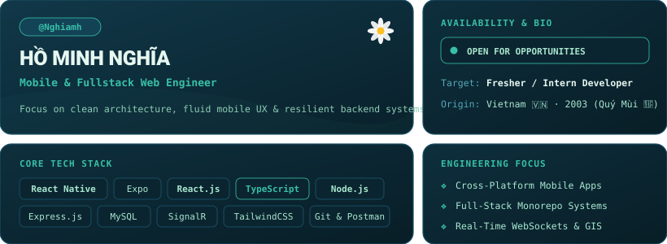

  <!-- Bento Grid Dashboard Component (No Avatar Required) -->
  

    

  <!-- Minimalist Badges -->
  
  &nbsp;
  
  &nbsp;
  

 

---

### 🚀 Featured Engineering Projects

| Project | Description | Tech Stack | Repository |
| :--- | :--- | :--- | :--- |
| **ArenaS Platform** | Sports Arena Booking System (Backend, Web & Mobile Monorepo) | React Native, React.js, Node.js, Express, MySQL | [🔗 ArenaS-Platform](https://github.com/Nghiamh/ArenaS-Platform) |
| **Emergency Dispatch** | Real-time Emergency Response & Fleet Dispatch Management | React 19, TypeScript, SignalR, Mapbox GL, TailwindCSS | [🔗 emergency-dispatch-frontend](https://github.com/emergency-dispatch/emergency-dispatch-frontend) |

---

### 🛠️ Core Capabilities

- **Mobile & Frontend:** React Native, Expo, React.js 19, TailwindCSS, NativeWind, HTML5/CSS3
- **Backend & Realtime:** Node.js, Express.js, TypeScript, SignalR (WebSockets), RESTful APIs
- **Databases & DevOps:** MySQL, MongoDB, Git, GitHub, Vite, Postman, VS Code

---

  <em><strong>🌼 "Clean code, fluid UX, and resilient architecture."</strong></em>

